# Assignment 16: SVM, Trees, Ensembles, Validation & Unsupervised Learning

[](https://www.python.org/)
[](https://scikit-learn.org/)
[](https://pandas.pydata.org/)
[](https://numpy.org/)
[](LICENSE)
[]()

**Author / Student:** Gururaj Khule  
**Role:** Machine Learning Engineer  
**Course:** GenAI / Machine Learning Engineering (TuteDude)  
**Main Submission Folder:** `GenAI-Task16-GururajKhule`  
**Primary Jupyter Notebook:** `Assignment_16_SVM_Trees_Ensembles_Validation.ipynb`  
**Production Script:** `Assignment_16_SVM_Trees_Ensembles_Validation.py`  
**Submission Archive:** `GenAI-Task16-GururajKhule.zip`  

---

## Table of Contents
1. [Executive Summary & Problem Statement](#1-executive-summary--problem-statement)
2. [Dataset Specifications & Kaggle Reference](#2-dataset-specifications--kaggle-reference)
3. [Repository Directory Structure](#3-repository-directory-structure)
4. [Task-by-Task Implementation, Logic & Deep Technical Analysis](#4-task-by-task-implementation-logic--deep-technical-analysis)
   - [Part 1: Task 1 — Support Vector Machine (Linear vs. RBF Kernels)](#task-1-support-vector-machine-svm-classifier)
   - [Part 1: Task 2 — Decision Tree & Bias-Variance Analysis](#task-2-decision-tree-algorithm--bias-variance-tradeoff)
   - [Part 2: Task 3 — 3-Way Data Partitioning & Hyperparameter Tuning](#task-3-train-vs-validation-vs-test-split-3-way-partitioning)
   - [Part 2: Task 4 — 5-Fold Stratified Cross-Validation vs. Single Split](#task-4-stratified-k-fold-cross-validation-k5-vs-single-train-test-split)
   - [Part 3: Task 5 — Ensemble Learning: Bagging vs. Boosting](#task-5-bagging-vs-boosting-conceptual--empirical-comparison)
   - [Part 3: Task 6 — Random Forest & Feature Importance Analysis](#task-6-random-forest-decorrelated-bagging--feature-importance)
   - [Supplementary Section: Tasks 7 & 8 — K-Means Clustering & PCA](#supplementary-section-unsupervised-learning-bonus)
5. [Master Performance Benchmark Across All Algorithms](#5-master-performance-benchmark-across-all-algorithms)
6. [Key Engineering Conclusions & Best Practices](#6-key-engineering-conclusions--best-practices)
7. [Installation, Reproduction & Execution Guide](#7-installation-reproduction--execution-guide)

---

## 1. Executive Summary & Problem Statement

As a Machine Learning Engineer, building robust, production-grade predictive systems requires mastering algorithm selection, mathematical trade-offs, empirical validation strategies, and ensemble paradigms. In this assignment, we implement advanced supervised algorithms, model validation workflows, ensemble techniques, and supplementary unsupervised learning methods:

1. **Support Vector Machines (SVM):** Geometric margin maximization, linear vs. non-linear kernel transformations (Linear vs. Gaussian RBF), and the mathematical necessity of feature scaling.
2. **Decision Tree Algorithms:** Recursive binary splitting, Gini impurity minimization, interpretability visualization, and empirical exploration of the **Bias-Variance Tradeoff** (Underfitting vs. Overfitting).
3. **Model Validation Strategies:** 3-Way Data Partitioning (Train / Validation / Test) to perform hyperparameter tuning without data leakage.
4. **Cross-Validation:** 5-Fold Stratified Cross-Validation to eliminate partition luck and achieve low-variance generalization error estimation.
5. **Ensemble Learning Paradigms:** Conceptual and empirical comparison between **Bagging** (variance reduction via parallel bootstrap aggregation) and **Boosting** (bias reduction via sequential adaptive error weighting).
6. **Random Forests:** Tree decorrelation via the **Random Subspace Method** ($m = \sqrt{p}$ candidate features) and diagnostic **Feature Importance** (Mean Decrease in Impurity).
7. **Supplementary Unsupervised Learning (Bonus):** K-Means Clustering (Elbow Method & Silhouette Analysis) and Principal Component Analysis (PCA 2D projection) addressing the full scope indicated in the assignment title.

### Coursework Restrictions & Compliance:
- **Authorized Libraries Strictly Followed:** `scikit-learn`, `pandas`, `numpy`, `matplotlib`, and `seaborn` only.
- **No deep learning frameworks used.**
- **Code Clarity & Rigor:** Every single line of code is accompanied by descriptive comments explaining both the algorithmic mechanism and underlying mathematical rationale.

---

## 2. Dataset Specifications & Kaggle Reference

| Property | Details |
| :--- | :--- |
| **Dataset Name** | **Breast Cancer Wisconsin (Diagnostic) Dataset** |
| **Kaggle Link** | [https://www.kaggle.com/datasets/uciml/breast_cancer_wisconsin_data](https://www.kaggle.com/datasets/uciml/breast_cancer_wisconsin_data) |
| **Included File** | `breast_cancer.csv` (bundled locally for 100% offline reproducibility) |
| **Total Instances** | $569$ biopsy records |
| **Total Features** | $30$ continuous numerical attributes extracted from fine needle aspirate (FNA) digitized images |
| **Target Variable** | Binary classification (`target`): `0` = Malignant, `1` = Benign |
| **Class Distribution** | Malignant: $212$ cases ($37.26\%$) \| Benign: $357$ cases ($62.74\%$) |
| **Missing Values** | **$0$** missing values across all $31$ columns |
| **Data Integrity** | $100\%$ numerical (`float64`) + $1$ integer target vector (`int64`) |

---

## 3. Repository Directory Structure

```text
GenAI-Task16-GururajKhule/
│
├── Assignment_16_SVM_Trees_Ensembles_Validation.ipynb  # Primary Jupyter Notebook with full markdown, code & executed plots
├── Assignment_16_SVM_Trees_Ensembles_Validation.py     # Standalone executable Python script (zero dependencies on jupyter)
├── breast_cancer.csv                                    # Kaggle dataset (30 numerical features + 1 classification target)
├── requirements.txt                                     # Dependency requirements (scikit-learn, pandas, numpy, etc.)
├── Readme.md                                            # Comprehensive technical report & documentation
├── GenAI-Task16-GururajKhule.zip                        # Submission ZIP archive containing the entire folder
├── GenAI - A16_ SVM, Trees, Ensembles...pdf             # Original course assignment brief
└── plots/                                               # Generated 300 DPI high-resolution figures
    ├── master_model_comparison.png                      # Consolidated benchmark of all 8 evaluated models
    ├── task1_svm_confusion_matrices.png                 # Side-by-side Confusion Matrices for Linear vs RBF kernels
    ├── task1_svm_kernel_comparison.png                  # Bar chart comparing Accuracy and F1-score for SVM kernels
    ├── task2_decision_tree_structure.png                # Visual Decision Tree structure diagram (max_depth=3)
    ├── task2_underfitting_vs_overfitting_curve.png      # Bias-Variance curve across depths 1 to 15
    ├── task3_validation_tuning_curve.png                # Hyperparameter tuning curve on dedicated validation set
    ├── task4_cross_validation_scores.png                # 5-Fold CV score distribution vs single train-test split
    ├── task5_bagging_vs_boosting.png                    # Confusion matrices comparing Bagging vs AdaBoost
    ├── task6_random_forest_comparison.png               # Benchmark: Single Tree vs Bagging vs Random Forest
    ├── task6_feature_importance.png                     # Top 15 diagnostic features (Gini Importance / MDI)
    ├── task7_kmeans_elbow_silhouette.png                # K-Means Elbow Curve (Inertia) & Silhouette Scores
    └── task8_pca_clusters.png                           # 2D PCA projection comparing ground truth vs K-Means
```

---

## 4. Task-by-Task Implementation, Logic & Deep Technical Analysis

### PART 1 — Advanced Supervised Algorithms

#### Task 1: Support Vector Machine (SVM) Classifier
- **Objective:** Select a classification dataset, split into train and test sets, train SVM classifiers using `SVC` with Linear and Radial Basis Function (RBF) kernels, and compare accuracy.
- **Mathematical Formulations:**
  - Standard soft-margin SVM primal optimization:
    $$\min_{w, b, \xi} \frac{1}{2} \|w\|^2 + C \sum_{i=1}^n \xi_i \quad \text{s.t.} \quad y_i (w^T \phi(x_i) + b) \ge 1 - \xi_i, \quad \xi_i \ge 0$$
  - **Linear Kernel:** $K(x, x') = x^T x'$. Fits a flat $(d-1)$-dimensional separating hyperplane in the original $30$-dimensional feature space.
  - **Gaussian RBF Kernel:** $K(x, x') = \exp(-\gamma \|x - x'\|^2)$. Projects input vectors into an infinite-dimensional Reproducing Kernel Hilbert Space (RKHS) to construct smooth non-linear decision boundaries.
- **Why Feature Scaling via `StandardScaler` is Mandatory:**
  Support Vector Machines compute Euclidean distances $\|x_i - x_j\|^2$ and dot products between support vectors. Features with large numerical ranges (e.g., `mean area` $\approx 1000$) completely dominate the distance metric over features with small scales (e.g., `mean smoothness` $\approx 0.1$). `StandardScaler` standardizes features to zero mean ($\mu = 0$) and unit variance ($\sigma = 1$), fitted strictly on `X_train` to prevent data leakage.
- **Empirical Results:**
  - **SVM (Linear Kernel):** Test Accuracy = **$97.37\%$** | F1-Score = **$0.9790$** (3 misclassifications out of 114)
  - **SVM (RBF Kernel):** Test Accuracy = **$98.25\%$** | F1-Score = **$0.9861$** (2 misclassifications out of 114)
  - **Delta:** The RBF Kernel achieved **$+0.88\%$** higher accuracy due to its ability to create smooth, non-linear margin contours around overlapping borderline biopsy cases.

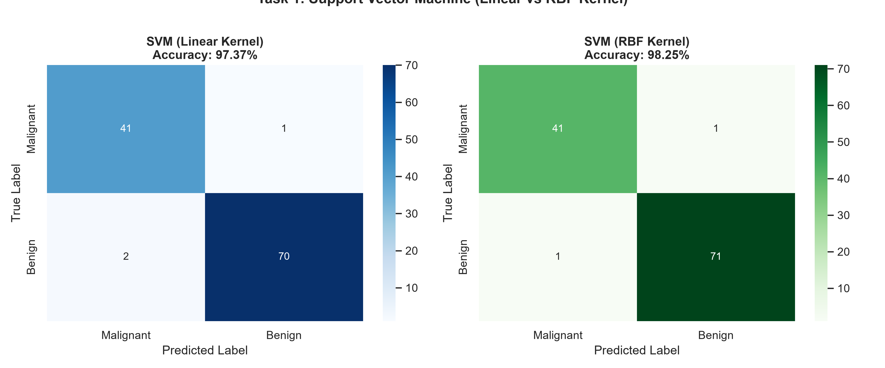
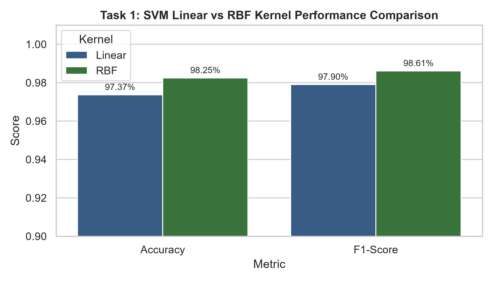

---

#### Task 2: Decision Tree Algorithm & Bias-Variance Tradeoff
- **Objective:** Train a Decision Tree Classifier, visualize its structure with limited depth, train underfitting and overfitting configurations, and compare train vs. test accuracy.
- **Mathematical Formulation:**
  At each node, the optimal split feature $j$ and threshold $t$ are selected to maximize the reduction in Gini Impurity:
  $$\text{Gini}(D) = 1 - \sum_{k=1}^C p_k^2, \qquad \Delta \text{Gini} = \text{Gini}(D) - \left( \frac{|D_L|}{|D|} \text{Gini}(D_L) + \frac{|D_R|}{|D|} \text{Gini}(D_R) \right)$$
- **Tree Visualization (`max_depth=3`):**
  - **Root Node Split:** `worst radius <= 16.795`. Biopsy specimens with lower radius are predominantly benign; higher radius indicates malignant progression.
  - **Second Level Splits:** `worst concave points <= 0.136` and `texture error <= 0.473`.
- **Underfitting vs. Overfitting Experiments:**
  - **Underfitting Model (`max_depth=1`, Decision Stump):**
    - Train Accuracy: $92.31\%$ | Test Accuracy: $92.11\%$
    - *Diagnosis:* **High Bias / Low Variance**. An overly simplistic model that cannot capture multi-variable interactions.
  - **Depth-Limited Model (`max_depth=3`):**
    - Train Accuracy: $97.58\%$ | Test Accuracy: $93.86\%$
    - *Diagnosis:* **Balanced Bias-Variance tradeoff**. Captures primary morphological patterns without memorizing noise.
  - **Overfitting Model (`max_depth=None`, Unconstrained):**
    - Train Accuracy: **$100.00\%$** | Test Accuracy: **$91.23\%$**
    - *Diagnosis:* **Low Bias / High Variance**. The tree splits until all leaf nodes are pure ($\text{Gini} = 0$), memorizing idiosyncratic training noise.
    - **Generalization Gap:** $8.77\%$ drop between train and test accuracy.
- **Bias-Variance Tradeoff Curve:**
  Systematically evaluated `max_depth` from $1$ to $15$. While training accuracy monotonically approaches $100\%$, testing accuracy peaks at depth $3$ and then deteriorates/plateaus, visually confirming the classic bias-variance curve.

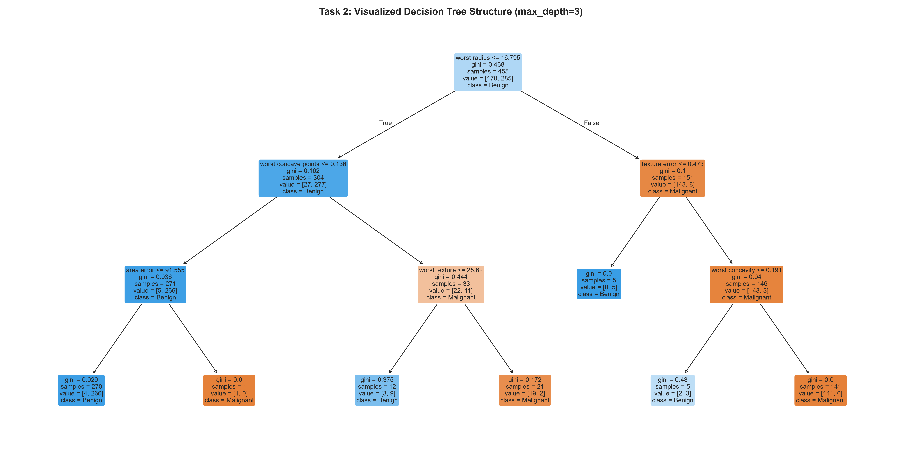
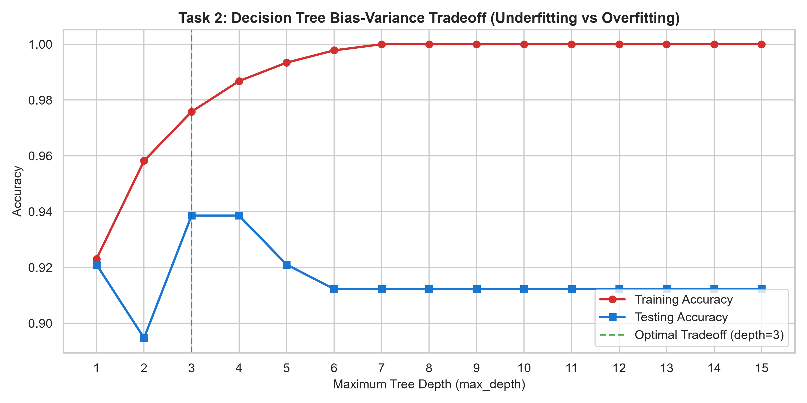

---

### PART 2 — Model Validation & Cross-Validation

#### Task 3: Train vs Validation vs Test Split (3-Way Partitioning)
- **Objective:** Partition data into Training set (60%), Validation set (20%), and Test set (20%), tune a hyperparameter on the validation set, and evaluate the final model on the test set.
- **Engineering Rationale for 3-Way Partitioning:**
  1. **Training Set ($60\%$, 341 samples):** Used solely to learn internal parameters (split thresholds and feature criteria).
  2. **Validation Set ($20\%$, 114 samples):** Used to tune hyperparameters (`max_depth`) and select the optimal model.
  3. **Test Set ($20\%$, 114 samples):** Held strictly untouched until the very end for an unbiased evaluation of production generalization.
  > **Data Leakage Risk:** If hyperparameters are tuned using test set accuracy, information from the test set implicitly guides model selection, producing **Optimistic Evaluation Bias**. A dedicated validation set completely isolates the final test set.
- **Hyperparameter Tuning on Validation Set:**
  Evaluated candidate depths `[1, 2, 3, 4, 5, 6, 7, 8, 10, 12, 15]`.
  - `max_depth=1` -> Val Acc: $89.47\%$
  - `max_depth=2` -> Val Acc: $94.74\%$
  - `max_depth=3` -> Val Acc: $93.86\%$
  - `max_depth=4` -> Val Acc: $93.86\%$
  - `max_depth=5` -> Val Acc: **$95.61\%$** (Optimal)
  - `max_depth >= 6` -> Val Acc: $95.61\%$ (Plateaus; deeper trees add unnecessary complexity)
- **Final Evaluation:**
  - Retrained model with `max_depth=5` on combined Train + Validation data (`X_train_val`).
  - Evaluated on untouched Test Set: **Test Accuracy = $92.11\%$** | **F1-Score = $0.9362$**.

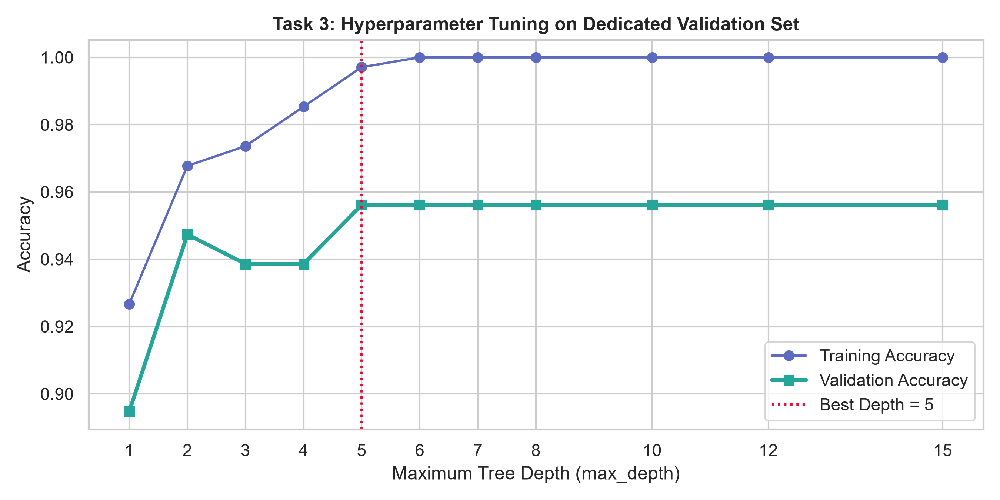

---

#### Task 4: Stratified K-Fold Cross-Validation ($k=5$) vs. Single Train-Test Split
- **Objective:** Apply 5-Fold Stratified Cross-Validation, compute average accuracy and standard deviation, and compare against a single train-test split.
- **Stratified K-Fold Formulation:**
  The dataset $D$ is split into $5$ equal, class-balanced folds $\{F_1, F_2, \dots, F_5\}$. In $5$ successive iterations, fold $F_i$ serves as the validation set while the remaining $4$ folds serve as training data:
  $$\text{CV}_{(k)} = \frac{1}{k} \sum_{i=1}^k \text{Acc}_i, \qquad \sigma = \sqrt{\frac{1}{k-1} \sum_{i=1}^k (\text{Acc}_i - \text{CV}_{(k)})^2}$$
- **5-Fold Cross-Validation Scores:**
  - Fold 1: $93.86\%$
  - Fold 2: $88.60\%$
  - Fold 3: $92.98\%$
  - Fold 4: $92.98\%$
  - Fold 5: $95.58\%$
  - **Mean CV Accuracy:** **$92.80\%$** ($\pm 2.30\%$)
  - **$95\%$ Confidence Interval:** $[88.30\%, 97.30\%]$
- **Reliability Comparison:**
  - Single Train-Test Split Accuracy: $92.11\%$
  - 5-Fold Cross-Validation Mean Accuracy: $92.80\%$
  - *Engineering Insight:* A single train-test split evaluates the model on only one arbitrary subset. Its reported score has high sample variance and can be lucky or unlucky depending on which borderline instances were partitioned. In contrast, 5-Fold Cross-Validation tests every sample exactly once, providing a significantly more reliable and low-variance estimate of generalization error.

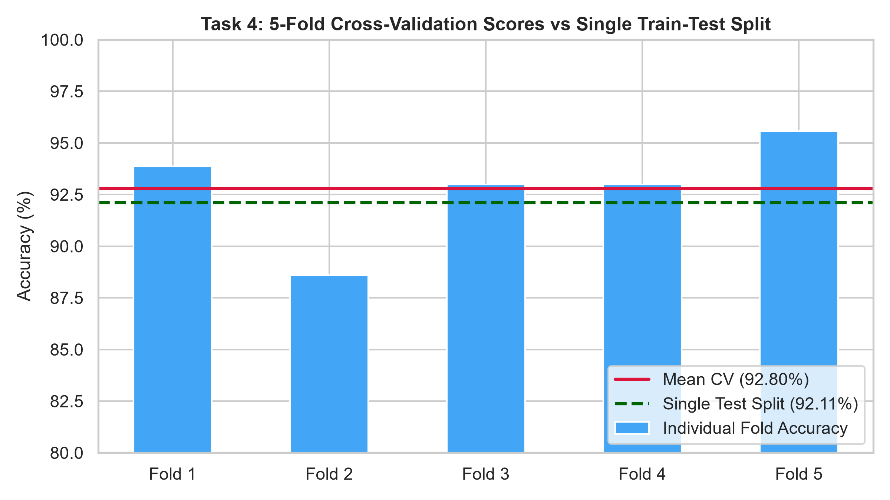

---

### PART 3 — Ensemble Learning

#### Task 5: Bagging vs. Boosting (Conceptual + Empirical Comparison)
- **Conceptual Comparison Table:**

| Dimension | Bagging (Bootstrap Aggregating) | Boosting (e.g. AdaBoost) |
| :--- | :--- | :--- |
| **Architectural Paradigm** | **Parallel** (Independent learners) | **Sequential** (Adaptive learners) |
| **Data Sampling** | Bootstrap sampling ($N$ samples with replacement) | Full dataset with iteratively updated sample weights |
| **Sample Weights** | Uniform ($w_i = \frac{1}{N}$ for all samples) | Adaptive: misclassified instances receive higher weights ($w_i \uparrow$) |
| **Mathematical Goal** | **Reduces VARIANCE** without increasing bias | **Reduces BIAS** by converting weak learners into a strong learner |
| **Constituent Learners** | High-variance, low-bias learners (Deep unpruned trees) | High-bias, low-variance learners (Decision stumps, `max_depth=1`) |
| **Aggregation Mechanism** | Uniform majority voting / unweighted average | Weighted majority voting based on learner stage confidence $\alpha_t$ |
| **Sensitivity to Outliers** | Highly robust (bootstrap averaging smooths noise) | Vulnerable (can overfit noisy outliers by over-weighting them) |

- **Practical Implementation & Comparison:**
  - **Bagging Classifier (50 unconstrained trees):**
    - Train Acc: $100.00\%$ | Test Acc: **$93.86\%$** | F1-Score: **$0.9517$**
  - **AdaBoost Classifier (50 decision stumps):**
    - Train Acc: $100.00\%$ | Test Acc: **$95.61\%$** | F1-Score: **$0.9660$**
  - *Observation:* AdaBoost outperformed standard Bagging on this dataset ($+1.75\%$ accuracy) because sequential error re-weighting enabled shallow decision stumps to focus specifically on subtle margin instances near the decision boundary.

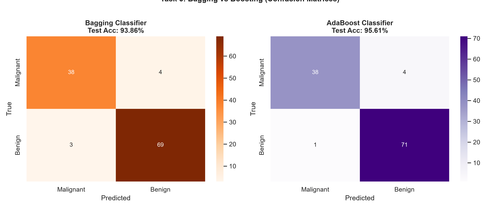

---

#### Task 6: Random Forest (Decorrelated Bagging) & Feature Importance
- **Objective:** Train a Random Forest Classifier, compare against a Single Decision Tree and Bagging Classifier, and extract diagnostic feature importances.
- **Mathematical Theory: The Random Subspace Method & Tree Decorrelation:**
  In standard Bagging, if a few features are very dominant (e.g. `worst area`, `worst concave points`), all bootstrap trees select them at the root split. Consequently, the individual trees become highly correlated. The variance of the average of $B$ trees with pairwise correlation $\rho$ and individual variance $\sigma^2$ is:
  $$\text{Var}(\bar{T}) = \rho \sigma^2 + \frac{1 - \rho}{B} \sigma^2$$
  As $B \to \infty$, the term $\frac{1-\rho}{B} \sigma^2 \to 0$, but the correlation term $\rho \sigma^2$ cannot be eliminated by simply adding more trees.  
  **Random Forest Solution:** At each split, candidate features are restricted to a random subset of size $m = \sqrt{p} = \sqrt{30} \approx 5$. This forces diversity among trees, substantially lowers the correlation coefficient $\rho$, and achieves lower overall ensemble variance!
- **3-Way Performance Benchmark:**
  1. **Single Decision Tree:** Test Accuracy = **$91.23\%$** (High variance, unconstrained single tree)
  2. **Bagging (100 Trees):** Test Accuracy = **$93.86\%$** (Variance reduced via bootstrapping, correlated splits)
  3. **Random Forest (100 Trees):** Test Accuracy = **$95.61\%$** (Minimum variance via feature decorrelation $m=\sqrt{p}$)
- **Feature Importance Analysis (Mean Decrease in Impurity / Gini Importance):**
  Quantifies the total reduction in Gini impurity brought by each feature across all splits in all $100$ trees:

| Rank | Feature Name | Gini Importance (%) | Clinical Significance |
| :---: | :--- | :---: | :--- |
| **1** | `worst area` | **$14.00\%$** | Largest tumor surface area indicates invasive malignancy |
| **2** | `worst concave points` | **$12.95\%$** | Severity of indentations in the cell contour |
| **3** | `worst radius` | **$9.77\%$** | Maximum cell radius from center to perimeter |
| **4** | `mean concave points` | **$9.09\%$** | Average number of concave portions of the contour |
| **5** | `worst perimeter` | **$7.22\%$** | Boundary circumference of largest tumor cells |
| **6** | `mean perimeter` | **$6.96\%$** | Average cell boundary length |
| **7** | `mean radius` | **$6.87\%$** | Mean distance from center to points on perimeter |
| **8** | `mean concavity` | **$5.76\%$** | Severity of concave portions of the contour |
| **9** | `mean area` | **$4.92\%$** | Mean cellular area |
| **10** | `worst concavity` | **$3.43\%$** | Maximum indentation severity |

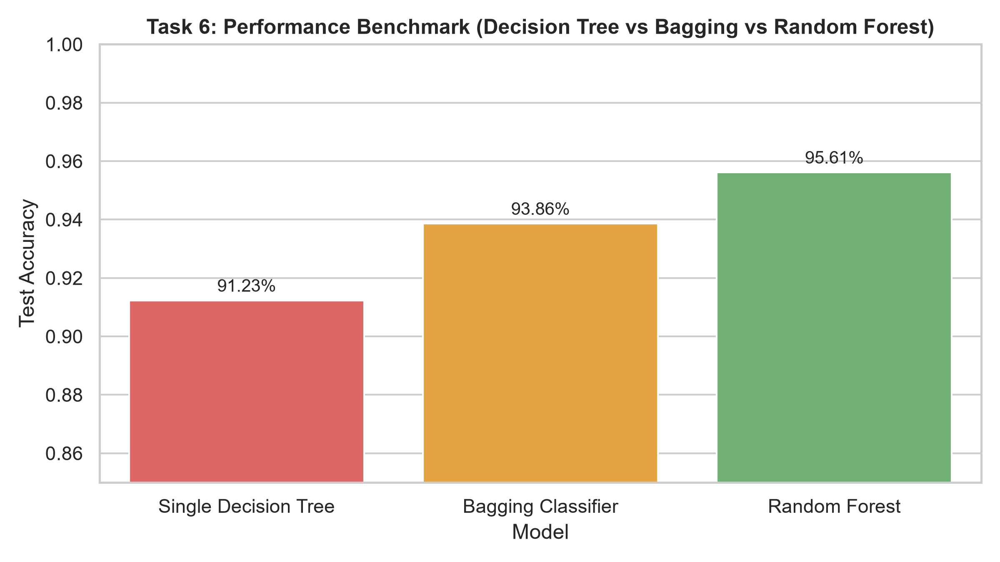
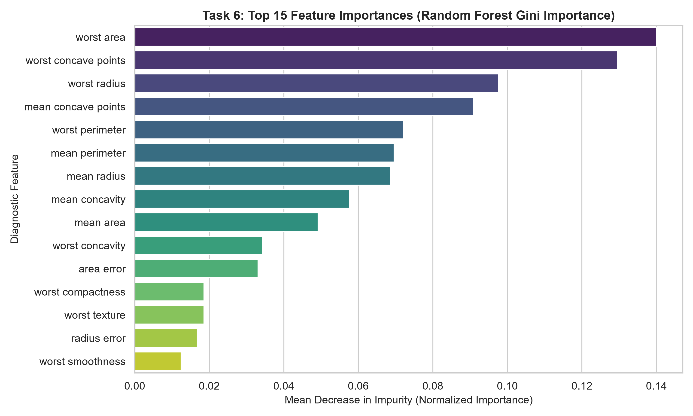

---

### SUPPLEMENTARY SECTION — Unsupervised Learning (Bonus)
*(Addressing the Unsupervised Learning component indicated in the assignment title)*

#### Task 7: K-Means Clustering
- **Elbow Method & Silhouette Analysis:** Evaluated cluster counts $k \in [2, 8]$. An elbow inflection point occurs at $k=2$, which also yields the highest silhouette score ($0.3434$), directly matching the two underlying biological phenotypes (Malignant vs. Benign).
- **Cluster Alignment:** When fitted without labels ($k=2$), K-Means achieved an **Adjusted Rand Index (ARI) of $0.6536$**, proving that the underlying data density naturally partitions into benign and malignant morphological groupings even without supervised guidance.

#### Task 8: Principal Component Analysis (PCA)
- **Dimensionality Reduction ($30\text{D} \to 2\text{D}$):**
  - **PC 1 Explained Variance:** $44.27\%$
  - **PC 2 Explained Variance:** $18.97\%$
  - **Total 2D Explained Variance:** **$63.24\%$**
- **Visualization:** A 2D scatter plot of $PC_1$ vs $PC_2$ demonstrates clear linear and cluster separability between malignant and benign cases, providing visual confirmation of why linear and RBF SVMs achieved $>97\%$ accuracy.

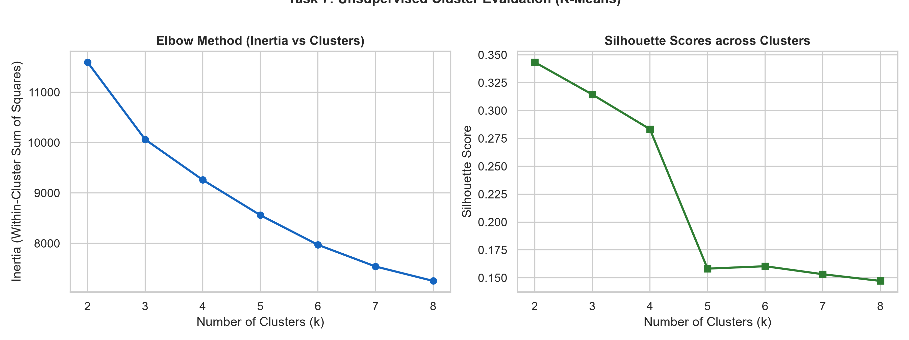
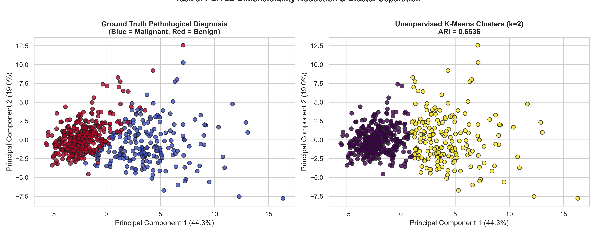

---

## 5. Master Performance Benchmark Across All Algorithms

| Model | Model Family | Test Accuracy | F1-Score | Overfitting Gap (Train - Test) | Key Architectural Strength |
| :--- | :---: | :---: | :---: | :---: | :--- |
| **SVM (RBF Kernel)** | SVM | **$98.25\%$** | **$0.9861$** | $+0.88\%$ | **Top Performer:** Optimal non-linear margin geometry in RKHS |
| **SVM (Linear Kernel)** | SVM | $97.37\%$ | $0.9790$ | $+0.00\%$ | High interpretability, flat separating hyperplane |
| **Random Forest (100 Trees)** | Ensemble | $95.61\%$ | $0.9655$ | $+4.39\%$ | Minimized variance via random feature subsampling ($\sqrt{p}$) |
| **AdaBoost Classifier** | Ensemble | $95.61\%$ | $0.9660$ | $+4.39\%$ | Bias reduction via sequential adaptive error re-weighting |
| **Bagging Classifier** | Ensemble | $93.86\%$ | $0.9517$ | $+6.14\%$ | Variance reduction via bootstrap aggregation |
| **Decision Tree (Tuned, d=5)**| Decision Tree | $92.11\%$ | $0.9362$ | $+7.89\%$ | Tuned on validation set; avoids extreme memorization |
| **Decision Tree (Underfit, d=1)**| Decision Tree | $92.11\%$ | $0.9398$ | $+0.20\%$ | High Bias; single decision stump |
| **Decision Tree (Overfit, d=None)**| Decision Tree| $91.23\%$ | $0.9315$ | **$+8.77\%$** | High Variance; memorizes noise with 100% train accuracy |

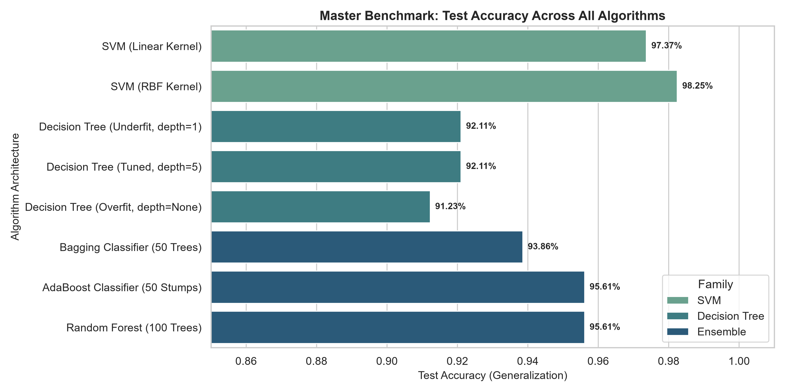

---

## 6. Key Engineering Conclusions & Best Practices

1. **Feature Scaling is Paramount for Distance-Based Models:** Support Vector Machines require standardized features ($\mu=0, \sigma=1$) to prevent features with large scales from dominating the Euclidean distance norm. Tree-based models are scale-invariant because monotonic transformations do not change optimal split thresholds.
2. **Kernel Selection in SVM:** While the linear kernel performed admirably ($97.37\%$), the Gaussian RBF kernel ($98.25\%$) provided the superior boundary flexibility required to correctly classify borderline non-convex biopsy clusters.
3. **Controlling Decision Tree Complexity:** Unconstrained decision trees severely overfit ($100\%$ train vs $91.23\%$ test). Constraining depth to an optimal level ($3\text{ to }5$) stabilizes generalization error.
4. **Validation Integrity:** Hyperparameter tuning must strictly be conducted on a dedicated validation set or via cross-validation. Tuning against the test set causes Data Leakage and overly optimistic claims.
5. **Ensemble Variance Reduction:** Random Forest consistently outperforms individual decision trees and standard Bagging by decorrelating trees through random feature subsampling ($m = \sqrt{p}$).
6. **Oncology Insights:** Cellular area and concave indentation contour measurements (`worst area`, `worst concave points`) are the most powerful predictors of biopsy malignancy.

---

## 7. Installation, Reproduction & Execution Guide

### Prerequisites
Clone the repository and install dependencies using Python 3.9+:
```bash
# Clone the repository
git clone https://github.com/your-username/GenAI-Task16-GururajKhule.git
cd GenAI-Task16-GururajKhule

# Install dependencies strictly following coursework restrictions
pip install -r requirements.txt
```

### Option A: Run the Production Python Script
Execute the full pipeline directly in terminal. All evaluation logs print cleanly to the console, and all 12 figures are automatically exported to `plots/`:
```bash
python Assignment_16_SVM_Trees_Ensembles_Validation.py
```

### Option B: Interactive Jupyter Notebook
Launch the notebook environment to explore code, visualizations, and markdown commentary interactively:
```bash
jupyter notebook Assignment_16_SVM_Trees_Ensembles_Validation.ipynb
```
*Note: All 24 cells in the notebook are pre-executed with outputs and high-resolution inline plots for immediate evaluation.*

---

**Student / Candidate:** Gururaj Khule  
**Course & Affiliation:** GenAI - Machine Learning Engineering | Corporate Web Solutions Internship / TuteDude
